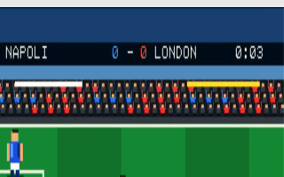

# Sensational Soccer

An original, horizontally scrolling six-a-side soccer cartridge for the PRG32 RISC-V console.

The touchline camera follows play across a 960-pixel pitch. Animated multi-frame players walk, control and kick the ball; dedicated keepers track, dive and save in both normal and demo play. Detailed celebrating spectators, ball height and bounce, momentum, spin, collisions, match effects, offline AI, and network opposition create an original game inspired by the readability—not the protected art, code, names, or content—of early home-computer football games.

Choose home and away identities from Napoli, London, Tokyo, and Rio, then play a single match or a three-round championship. Music is reserved for title and result screens; the match mix contains only football effects and goal celebrations.

## Controls

| Control | Action |
|---|---|
| Stick | Move the selected blue player |
| A | Shoot |
| B | Pass forward |
| SELECT | Return to title/menu |

When two consoles join the `sensational-soccer-v2` multiplayer room, the first remote peer controls the away team. With no peer, away remains AI-controlled. The Central European night release starts at volume zero; the full soundtrack and event mix remain packaged for daytime use and promotional capture.

## Build

Set `PRG32_REPO` if the PRG32 checkout is not the adjacent `../PRG32`, then run `./build.sh`. The script produces ESP32-C6 and QEMU cartridges plus a ready-to-publish Store bundle in `dist/`.

See [docs/architecture.md](docs/architecture.md) for implementation details.
See [docs/reproducibility.md](docs/reproducibility.md) for exact build, QEMU, board, and multiplayer test procedures.
